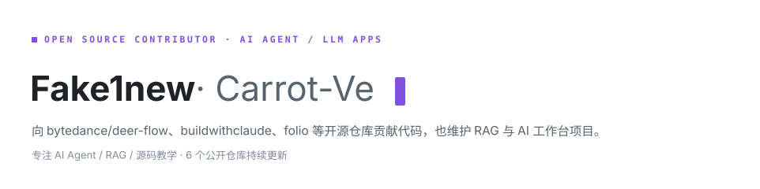
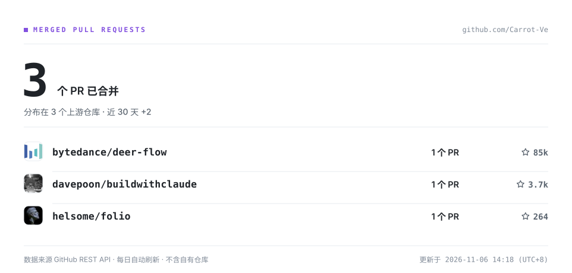

<picture>
  <source media="(prefers-color-scheme: dark)" srcset="./assets/hero-dark.svg">
  
</picture>

<picture>
  <source media="(prefers-color-scheme: dark)" srcset="./assets/merged-prs-dark.svg">
  
</picture>

<!-- STATS:BEGIN -->
**4** 个 PR 已被合并，分布在 4 个上游仓库（不含自有仓库）· 数据由 [`generate_stats.py`](./scripts/generate_stats.py) 每日直连 GitHub API 刷新
<!-- STATS:END -->

## 代表项目

**CrisisLens** —— 对话式调查工作台：接入 API 模型进行多轮追问式调查，网络来源全程可溯源，并用本地 Langfuse 做可观测性。

[仓库](https://github.com/Carrot-Ve/CrisisLens) · TypeScript

---

**考公 AI 小助手** —— 本地大模型 + RAG + LangGraph 的备考助手：Dense/BM25/RRF 混合检索、BGE 精排、ReAct 工具调用、MySQL 检查点与公共/私有知识库审核，本地回归 154 个测试用例。

[仓库](https://github.com/Carrot-Ve/kaogong-ai-assistant) · Python · FastAPI + Streamlit + Ollama + ChromaDB

---

**source-teaching** —— 面向初学者的中文源码逻辑教学 Skill：整体逻辑、流程图、贯穿案例与证据约束，让「读源码」变成可复现的教学流程。

[仓库](https://github.com/Carrot-Ve/source-teaching) · MIT

---

<picture>
  <source media="(prefers-color-scheme: dark)" srcset="https://raw.githubusercontent.com/Carrot-Ve/Carrot-Ve/output/github-contribution-grid-snake-dark.svg">
  
</picture>
